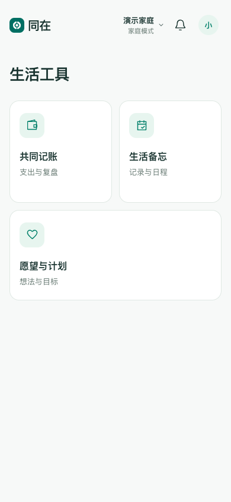
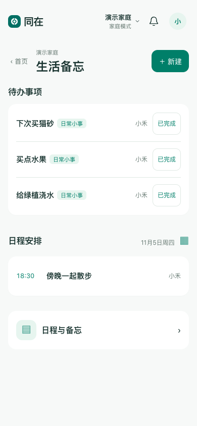
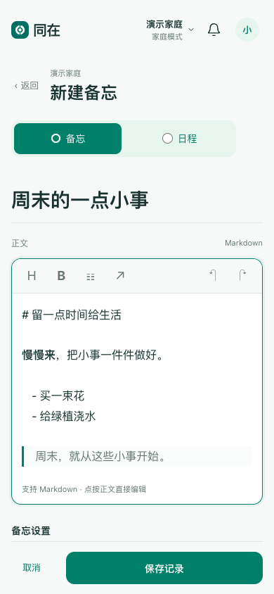

# 同在 · Shared Life

一款可自建的共同生活 PWA，把共同记账、生活备忘、愿望与计划放在同一个入口。适合个人和受邀家庭成员使用。

  

截图使用专属演示数据。

## V2 可以做什么

- 私人和家庭内容分开；支持多个家庭、邀请、退出、移交管理员和解散家庭。
- 共同记账：支出记录、分类、图片、退款、更正请求及统计。金额用整数分计算，统计使用已同步净额，退款归原消费月份；当前只支持人民币。
- 生活备忘：统一记录、附件、分类与关注；支持每天多个时间、每周多个星期和每月多个日期，并保留公历／农历年度重复；每个提醒时点分别完成，早间完成后晚间提醒仍保留。时／分使用可见选择控件，支持任意分钟；首页保持一条原关注，日历分别显示各时点。
- 首页待办按原创建时间倒序，支持纵向滚动、新建备忘和快速记账；旧任务没有真实创建时间时排在后面。点击顶栏“同在”返回首页并触发既有同步。
- 愿望与计划：手动整理计划与任务，将任务加入首页待办并共用完成状态。
- 本机优先保存；同步中或有待传、离线及异常时，在顶部图标查看同步详情，健康空闲时隐藏。首次联网准备好应用资源后，可使用已支持的离线记录能力。
- PWA打开、返回前台或恢复联网时检查新版；新资源就绪且没有未保存输入或进行中请求时安全切换，保留当前范围及本机待同步记录／图片。旧窗口所需资源在旧页面关闭前保留；首次从没有新更新监听的旧版本进入本版仍可能需要正常重开一次，不清网站数据。
- 系统通知区分备忘、月报和每周补评，点击可定位对应内容；应用内消息可查看或逐条忽略，内容失效时明确反馈。

- 愿望 AI 规划：围绕愿望或计划持续讨论，主动选择本条资料，按需联网核实，查看结构化阶段／任务草案，再由成员明确采纳；草案不会自动改写正式计划。
- 月度 AI 财务分析：复用程序计算的月度快照与金额，提供消费解释和逐笔来源，支持补充评价后更新分析。

AI 默认关闭，手动记账、备忘与计划可独立使用。详见 [路线图](ROADMAP.md)。

## 快速开始

需要 Python 3.13、uv，以及 Node.js 24.12+（或满足依赖要求的 Node.js 22.18+）。在项目根目录执行：

```sh
uv sync --locked
./scripts/web.sh ci
./scripts/web.sh run build
uv run python -m scripts.seed_demo --database .local/dev.sqlite3
uv run python -m server.main
```

打开 <http://127.0.0.1:8765>。演示账号为 `demo-a`、`demo-b`，密码均为 `demo-only-2026`，只用于本机虚构数据；演示数据库已存在时种子脚本会拒绝覆盖。再次启动只需执行最后一条命令。独立注册的账号默认只有私人内容，主动建家或接受邀请才加入家庭。

部署给真实成员前，应创建全新数据库和自己的账号，不开放演示账本。使用 HTTPS 反向代理并配置准确的允许来源及安全 Cookie；PWA 安装、Service Worker 和系统通知在远程访问时需要安全上下文。通用容器模板默认仅绑定本机端口：

```sh
docker compose up --build -d
```

容器数据保存在命名卷中；首次运行没有预置账号。模板默认关闭真实模型调用、推送与自动备份。`.env.example` 仅为进程环境参考，应用不会自动加载该文件。容器模式应在 `compose.yaml` 中显式配置需要的环境变量。

## 可选 AI 配置

两项能力固定使用 `gpt-6.1-sol / high / Standard`，仅服务端读取受保护的 `SHARED_EXPENSE_OPENAI_KEY_FILE`；文件必须是当前服务用户所有、仅该用户可读写的普通文件，不接受符号链接。不要把 key 放进前端、仓库、浏览器存储或日志。容器部署应以只读文件挂载，并让文件所有者与应用运行 UID 一致。

愿望 AI 由 `SHARED_EXPENSE_ALLOW_PLANNING_AI=1` 启用，月度 AI 由 `SHARED_EXPENSE_ALLOW_MODEL_CALLS=1` 启用；还必须将共享日调用门禁 `SHARED_EXPENSE_MODEL_CALL_LIMIT` 设为正数。保留默认的0就不会付费调用。两项能力共用按 Asia/Shanghai 自然月计算的应用级50美元预算，通过预留和结算控制费用。未知费用继续保留原预留并占用预算，不作为已确认扣费；剩余额度充足时允许用户主动发起新请求，余额不足仍拦截。未知月报步骤不会自动重发；这不是供应商账单或账号总消费上限。默认单价是代码配置，部署者应按实际供应商计价核对，参考 `.env.example`。

按需联网仅用于愿望 AI，可在提交时关闭；月度分析不联网。只有主动选中的本条资料随愿望请求发送，服务端仍检查成员与范围权限；月度分析使用所选范围的已同步财务快照及补评。启用前应确认成员知情及数据外发范围，并自行完成供应商、预算与部署验收。已有月报的启用状态及时间设置保持，不会因升级而全部打开。备份恢复后 AI 保持暂停，核对数据与用量后再显式启用，不自动恢复付费调用。

## 从 V1 升级

V2 使用 schema11。旧 schema10 数据库需要显式迁移，普通启动不会静默升级。先停止唯一写入服务，保留数据库、附件与原配置的受保护备份，在隔离副本演练迁移及恢复，再对正式库执行：

```sh
uv run python -m scripts.migrate_memos --database /path/to/ledger.sqlite3 --evidence /path/to/new-private-migration-evidence.json
```

以上是待替换的本机路径示例，不是可直接套用的生产命令。迁移会核对原有表及行值，并记录新私有证据；失败先查明同次结果，不重复覆盖或删证据。多日／多时间与逐时点完成写入现有JSON，无额外结构迁移，但schema相同不表示旧版能识别新字段；使用新规则后不能直接退回不兼容的2.0.10或更早程序，应使用兼容版本前向修复。升级后不能直接退回只支持旧 schema 的程序写入新库；恢复必须使用匹配版本和保护点，避免覆盖升级后的新增记录。发布源码不代表已代你迁移或启用 AI。

## 使用与数据边界

私人内容仅本人可见，家庭内容按具体家庭隔离。共同账目由原付款人维护，其他成员可提交更正请求；共同备忘与计划支持家庭成员编辑，删除由创建者决定。家庭历史的可见性随成员关系变化。失权后重新同步会撤回共同访问，已经看过或离线保存的信息不能立即远程抹除。

“已保存到本机”和“已同步到服务端”是不同状态。请保留未同步内容；清除网站数据会造成未同步记录丢失。关闭应用后的后台同步和提醒送达取决于设备与系统，不能保证。系统通知需要服务器配置和每台设备主动授权，真实手机送达、冷启动与网络切换应由部署者验证。

## 开发检查

```sh
uv run pytest server/tests server/plans/test_service.py tests/integration/test_family_migration.py tests/integration/test_family_admin_migration.py -q
python3 -m unittest discover -s tests/release -v
./scripts/web.sh test
./scripts/web.sh run build
```

这组命令覆盖后端模块、真实旧版本源码构造的虚构数据库迁移／恢复、计划模块、前端状态及生产构建。历史测试源码夹具随仓库提供并逐文件校验，不需要维护者的私人 Git 历史。它不代替完整浏览器、真机和生产恢复验收，也不承诺旧程序可以回退读取当前数据库。

页面开发可为后端允许来源增加 `http://127.0.0.1:5173`，再另开终端执行 `./scripts/web.sh run dev`；离线验收应使用生产构建。

兼容更新的参数化打包、保护备份、切换与资源核验见[发布说明](docs/releasing.md)。真实环境配置保存在仓库之外，不提交到公开项目。

## 设计取舍与限制

Vue / TypeScript 前端（Markdown 编辑器使用 CodeMirror 6）、FastAPI 后端、SQLite 数据库，采用单进程服务。依赖版本以 `web/package-lock.json` 与 `uv.lock` 为准，前述安装和 CI 命令会安装完整编辑器依赖。保存、同步、金额计算与权限边界优先于功能数量。项目仍在早期维护阶段，不提供托管服务或响应时效承诺，也不是支付、AA 结算或银行账单导入工具。

生产部署自行承担域名、TLS、访问控制、备份和恢复验证。数据库升级前应保留受保护备份；先在隔离副本验证，不能用旧程序直接写新结构，也不能用旧备份覆盖日常新增记录。

## 参与与许可

欢迎提供可复现的问题和小范围改进，见 [贡献说明](CONTRIBUTING.md)。请勿在 Issue 中上传真实账本、账号会话或私人附件；漏洞报告见 [安全政策](SECURITY.md)。

项目原创代码和原创图标采用 [MIT](LICENSE) 许可；第三方依赖保留各自许可，见 [第三方说明](THIRD_PARTY_NOTICES.md)。
